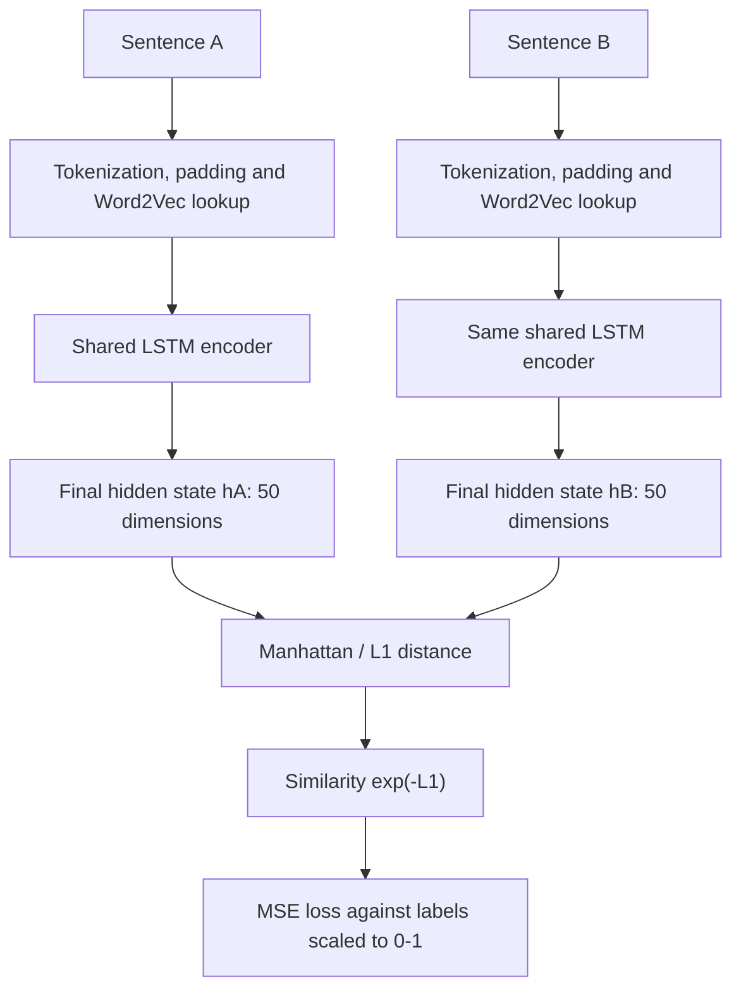

# Siamese-LSTM Sentence Similarity — PyTorch Reproduction

[](https://www.python.org/)
[](https://pytorch.org/)
[](https://doi.org/10.1609/aaai.v30i1.10350)

A Python 3.10/PyTorch reproduction project for **“Siamese Recurrent Architectures for Learning Sentence Similarity”** by Jonas Mueller and Aditya Thyagarajan (AAAI 2016). The goal is to preserve the paper's MaLSTM sentence-similarity computation while replacing the original Theano execution framework with PyTorch.

> **Reproduction status: partial, with measurable differences from the paper.** The current implementation runs the STS → SICK pipeline and reports raw and calibrated evaluation metrics, but it does not yet reproduce the paper's published scores. Important differences—including forget-gate initialization and gradient clipping—remain unresolved. This repository should not be described as an exact reproduction.

## Table of contents

- [Research background](#research-background)
- [Architecture](#architecture)
- [Research specifications](#research-specifications-and-status)
- [Implemented functionality](#implemented-functionality)
- [Repository layout](#repository-layout)
- [Data and pretrained embeddings](#data-and-pretrained-embeddings)
- [Environment and installation](#environment-and-installation)
- [Configuration](#configuration)
- [Running the project](#running-the-project)
- [Training pipeline](#training-pipeline)
- [Evaluation](#evaluation)
- [Experimental results](#experimental-results)
- [Known limitations and troubleshooting](#known-limitations-and-troubleshooting)
- [References, citation, and licensing](#references-citation-and-licensing)
  
## Research background

Sentence similarity estimates how closely two sentences express related meanings despite differences in wording or syntax. Mueller and Thyagarajan propose a Siamese adaptation of a Long Short-Term Memory network (LSTM): both sentences pass through the same encoder, and their fixed-size representations are compared using Manhattan distance.

The paper's key idea is to constrain sentence comparison to a simple, interpretable distance function. The encoder is trained on sentence pairs using mean squared error (MSE), with 300-dimensional pretrained word vectors, STS pretraining, SICK training, synonym-based augmentation, and a post-training nonparametric regression calibration step.

- **Paper:** [AAAI proceedings page](https://ojs.aaai.org/index.php/AAAI/article/view/10350)
- **DOI:** [10.1609/aaai.v30i1.10350](https://doi.org/10.1609/aaai.v30i1.10350)
- **Google Code Word2Vec archive:** [word2vec](https://drive.google.com/file/d/0B7XkCwpI5KDYNlNUTTlSS21pQmM/edit?pli=1&resourcekey=0-wjGZdNAUop6WykTtMip30g)

## Architecture

The intended MaLSTM computation is:



**Parameter sharing:** both sentence branches call one encoder module. The current implementation uses an explicit LSTM cell rather than `torch.nn.LSTM`, making the gate ordering, parameter layout, masking, and state updates visible in the code.

The sentence similarity function is

```math
s(a,b)=\exp\left(-\sum_{i=1}^{50}\left|h_i(a)-h_i(b)\right|\right)
```

where \(h(a)\) and \(h(b)\) are the final 50-dimensional hidden states. The resulting raw score lies approximately in \([0,1]\). During training, human relatedness labels on the SICK \([1,5]\) scale are rescaled to \([0,1]\), and MSE is minimized.

### Explicit LSTM computation

The implementation concatenates gates in the order **input, forget, output, cell candidate**. For each timestep, it computes the affine preactivation $`z_t = W x_t + U h_{t-1} + b`$, then applies sigmoid to the input, forget, and output gates and tanh to the cell candidate. The cell and hidden states are updated with the standard gated LSTM equations; a mask keeps the previous states unchanged at padding positions. The final representation is the hidden state at the last padded timestep, with masking intended to preserve the last valid state.

**Initialization discrepancy:** the current `lstm.py` sets the forget-gate bias to **1.5**, while the paper explicitly reports **2.5**. This is a documented unresolved methodological discrepancy, not a Python compatibility detail.

## Research specifications

| Specification | Intended/paper setup |
|---|---|
| Word vectors | 300-D Google News Word2Vec |
| Sentence encoder | Single-layer LSTM |
| Sentence representation | Final 50-D hidden state |
| Siamese branches | Shared parameters |
| Distance | Manhattan / L1 |
| Similarity | \(\exp(-L1)\) |
| Loss | MSE on labels rescaled to \([0,1]\) |
| Optimizer | AdaDelta |
| Forget-gate bias | 1.5 |
| STS pretraining | Before SICK training |
| SICK training | Fine-tuning after STS |
| Synonym augmentation | Thesaurus-based expansion |
| Regression calibration | Local-linear regression; bandwidth by LOOCV |
| Metrics | MSE, Pearson \(r\), Spearman \(\ρ\) |
| Determinism | Reproducible random state |

## Implemented functionality

- Python 3.10 compatibility layer around the original repository's APIs.
- Explicit PyTorch LSTM equations, masking, initialization, and final hidden-state extraction.
- Shared-weight Siamese MaLSTM with Manhattan distance and exponential similarity.
- Custom AdaDelta-style optimization and MSE training.
- Pickle loading with compatibility handling for legacy serialized resources.
- Google News Word2Vec loading through Gensim's `KeyedVectors` API.
- Ten-pass synonym augmentation with runtime counts for original examples, generated candidates, accepted examples, and final dataset size.
- STS pretraining followed by SICK training.
- SICK test evaluation with MSE, Pearson correlation, and Spearman correlation.
- Post-training local-linear regression calibration with leave-one-out bandwidth selection.
- Evaluation-only execution from a legacy `bestsem.p` checkpoint.
- A separate SICK entailment transfer module (`sentiment.py`) that builds 100-dimensional features from absolute differences and elementwise products and fits an RBF SVM. This is a distinct transfer-classification task, not the main relatedness-scoring pipeline.

## Repository layout

The project layout described for the working repository is:

```text
project/
├── Data/
│   ├── bestsem.p
│   ├── dwords.p
│   ├── GoogleNews-vectors-negative300.bin.gz   # must be obtained separately
│   ├── kaggle.p
│   ├── semtest.p
│   ├── semtrain.p
│   ├── stsallrmf.p
│   └── synsem.p
├── Paper/
│   └── 12195-56216-1-PB.pdf
└── Script/
    ├── calibration.py
    ├── lstm.py
    ├── main.py
    ├── mainmodel.py
    ├── sentences.py
    ├── sentiment.py
    ├── SiameseLSTM.py
    └── word_vectors.py
```

This tree is based on the supplied project layout and uploaded source files, not on a full Git checkout. Filenames may differ in the working directory; verify the actual casing and paths before running commands. No `requirements.txt`, license file, CI workflow, or project-specific GitHub URL was supplied for inspection.

| Module/artifact | Responsibility |
|---|---|
| `main.py` | CLI entry point; loads resources, runs STS → SICK training, evaluates, and reports calibration |
| `mainmodel.py` | Training/evaluation compatibility API, MSE, and AdaDelta-style updates |
| `lstm.py` | Explicit LSTM equations, parameter initialization, shared MaLSTM encoder, weight serialization |
| `SiameseLSTM.py` | Legacy compatibility helpers and Siamese model interface |
| `sentences.py` | Padding, masks, embedding lookup, and synonym augmentation |
| `word_vectors.py` | Gensim adapter for the 300-D Google News vectors |
| `calibration.py` | Local-linear calibration and metric calculation |
| `sentiment.py` | Separate SICK entailment transfer experiment using an RBF SVM |
| `stsallrmf.p` | STS pretraining records |
| `semtrain.p`, `semtest.p` | SICK training and test records |
| `synsem.p`, `dwords.p` | Synonym mappings and word/token dictionary used by preprocessing |
| `bestsem.p` | Legacy model weights/checkpoint used by evaluation-only mode |
| `kaggle.p` | Additional serialized artifact; its role in the main pipeline is not established by `main.py` |

The uploaded `data.zip` contains `semtrain.p`, `semtest.p`, `stsallrmf.p`, `synsem.p`, `dwords.p`, `bestsem.p`, and `kaggle.p`. It does **not** contain the Google News Word2Vec binary. Do not assume that the archive contains the complete runtime environment or every required resource.

## Data and pretrained embeddings

The main entry point expects the following files inside the directory passed to `--base-dir`:

| File | Use |
|---|---|---:|
| `stsallrmf.p` | STS pretraining dataset; with 11,219 records |
| `semtrain.p` | SICK training dataset; with 5,000 records |
| `semtest.p` | SICK test dataset; with 4,927 records |
| `synsem.p` | Synonym dictionary for augmentation |
| `dwords.p` | Token/word lookup mapping |
| `bestsem.p` | Legacy checkpoint for evaluation-only mode |
| `GoogleNews-vectors-negative300.bin.gz` or `.bin` | 300-dimensional pretrained embeddings |
| `kaggle.p` | Not required by the main entry point shown |

The `.p` files are legacy Python pickle artifacts. Only load pickle files from sources you trust; unpickling untrusted files can execute arbitrary code. The code includes compatibility handling for legacy Python 2-era pickles.

### Google News Word2Vec

Obtained the original pretrained resource from a legitimate source that permits intended use. The original Word2Vec archive is linked above. The expected filename is `GoogleNews-vectors-negative300.bin.gz` (or the uncompressed `.bin` file). The main script searches for either filename in `--base-dir` and requires 300-dimensional vectors. The full resource is large and may require substantial RAM to load.

Link to download:- https://drive.google.com/file/d/0B7XkCwpI5KDYNlNUTTlSS21pQmM/edit?pli=1&resourcekey=0-wjGZdNAUop6WykTtMip30g

Do not commit the multi-gigabyte embedding file or other data artifacts to GitHub unless you have verified their redistribution terms. Consider documenting the expected local path and keeping the file outside version control.

## Environment and installation

The uploaded source imports these third-party packages: PyTorch, NumPy, SciPy, Gensim, NLTK, scikit-learn, tqdm, and Rich. There is no supplied dependency lockfile or verified `requirements.txt`, so the commands below install unpinned packages and are **not** a fully pinned reproducibility environment.

### Create a virtual environment

**Windows PowerShell**

```powershell
py -3.10 -m venv .venv
.\.venv\Scripts\Activate.ps1
python -m pip install --upgrade pip
```

**Linux/macOS**

```bash
python3.10 -m venv .venv
source .venv/bin/activate
python -m pip install --upgrade pip
```

Install the imported dependencies:

```bash
python -m pip install torch numpy scipy gensim nltk scikit-learn tqdm rich
```

Install a PyTorch build appropriate for your machine from the [official PyTorch installation selector](https://pytorch.org/get-started/locally/). The model selects CUDA when available and otherwise uses CPU, but loading the full Word2Vec resource can still be memory-intensive. No dependency versions or CUDA configuration were verified as universally compatible for all systems.

If synonym augmentation is expected to use NLTK stopwords, install the corpus once:

```python
import nltk
nltk.download("stopwords")
```

The augmentation module falls back to an empty stop-word set when the NLTK corpus is unavailable, which can change augmentation results. For a strict reproduction run, record whether the corpus was available.

## Configuration

The CLI supports these arguments:

| Argument | Meaning | Default |
|---|---|---|
| `--base-dir PATH` | Directory containing datasets, dictionaries, embeddings, and checkpoint | Current working directory |
| `--checkpoint PATH` | Checkpoint path for evaluation-only mode | `bestsem.p` inside `--base-dir` |
| `--no-training` | Load `bestsem.p` and evaluate without STS/SICK training | Off |
| `--no-synonym-augmentation` | Disable augmentation and use the standard SICK epoch count | Off |

The entry point expects 11,219 STS records, 5,000 SICK training records, and 4,927 SICK test records; it raises an error if these counts do not match. It uses 66 STS epochs, 375 SICK epochs when augmentation is enabled, and 330 SICK epochs otherwise.

There is no CLI flag for setting a random seed, batch size, optimizer constants, or clipping threshold. The current code uses a batch size of 32, AdaDelta constants \(\rho=0.95\) and \(\epsilon=10^{-6}\), and custom initialization constants in `lstm.py`. These values should be recorded with each experiment.

## Running the project

Run commands from the repository root, adjusting folder names if your actual files are arranged differently.

### Full training and evaluation

```powershell
python .\Script\main.py --base-dir .\Data
```

This creates a fresh model, runs STS pretraining, optionally performs synonym augmentation (enabled by default), trains on SICK, then evaluates the SICK test set and reports raw and calibrated metrics. The visible code does not save a newly trained checkpoint as part of the documented main flow, so do not assume a new `bestsem.p` is written.

### Train without synonym augmentation

```powershell
python .\Script\main.py --base-dir .\Data --no-synonym-augmentation
```

### Evaluate an existing checkpoint without retraining

```powershell
python .\Script\main.py --base-dir .\Data --no-training
```

Use a non-default checkpoint path with:

```powershell
python .\Script\main.py --base-dir .\Data --no-training --checkpoint .\Data\bestsem.p
```

The `--checkpoint` option is used by evaluation-only mode. In the fresh training path, the code intentionally initializes a new model rather than loading the legacy checkpoint.

These commands match the argument parser in the supplied `main.py`, but they have not been executed in a clean environment here. They require all runtime files, especially the Google News vectors, to be present. The exact paths also depend on where the source files are placed.

## Training pipeline

1. **Resource loading:** load the Word2Vec model, `synsem.p`, and `dwords.p`.
2. **STS pretraining:** initialize a fresh model and train for 66 epochs on `stsallrmf.p`.
3. **SICK data loading:** load the 5,000-record SICK training set and preserve an unaugmented copy for calibration.
4. **Optional synonym augmentation:** run the repository-style ten-pass augmentation. The number accepted depends on the actual lexical resources and random choices; it is reported at runtime rather than forced to the paper's reported count.
5. **SICK training:** train for 375 epochs with augmentation, or 330 epochs without it.
6. **Raw evaluation:** score the 4,927-record SICK test set and compute MSE, Pearson, and Spearman after mapping similarity back to the \([1,5]\) scale.
7. **Calibration:** fit a local-linear regressor on raw predictions from the SICK training set, selecting bandwidth by leave-one-out cross-validation, then evaluate calibrated predictions on the test set.


## Evaluation

The main evaluation reports:

- **MSE:** mean squared difference between predicted and human relatedness scores; lower is better.
- **Pearson \(r\):** linear correlation between predictions and gold scores; closer to 1 is better.
- **Spearman \( ρ\):** rank correlation; closer to 1 is better.

Raw MaLSTM similarity is in \([0,1]\). The evaluation converts it to the SICK scale using \(4s+1\). Calibration is evaluated separately and produces predictions directly on the original \([1,5]\) target scale.

## Experimental results

### supplied execution output

| Evaluation | MSE ↓ | Pearson \(r\) ↑ | Spearman \(ρ\) ↑ |
|---|---:|---:|---:|
| Paper-reported MaLSTM (Table 2) | 0.03686 | 0.8109 | 0.7435 |
| Current reproduction — raw | 0.3645 | 0.8176 | 0.7504 |
| Current reproduction — calibrated | 0.3503 | 0.8209 | 0.7504 |

Absolute differences from the paper's reported values:

| Current result | MSE difference | Pearson difference | Spearman difference |
|---|---:|---:|---:|
| Raw reproduction minus paper | -0.0041 | +0.0067 | +0.0069 |
| Calibrated reproduction minus paper | -0.0182 | -0.0100 | +0.0069 |

The paper's results are from Table 2 of the AAAI 2016 paper.

## Known limitations and troubleshooting

### Missing Word2Vec resource

The supplied data folder does not include the Google News vectors. Download the resource from the given source link and place the expected `.bin.gz` or `.bin` file in the directory passed to `--base-dir`. The program raises `FileNotFoundError` if it is missing.

### Gensim, SciPy, NumPy, and Python compatibility

The code uses modern Gensim `KeyedVectors.load_word2vec_format`. Dependency versions are not pinned in the supplied files. If imports fail, create a clean Python 3.10 environment and install a mutually compatible set of NumPy, SciPy, and Gensim versions; record exact versions after resolving the environment.

### Memory use

The complete Google News vector file is large. Loading it may require several gigabytes of memory, regardless of whether model computation runs on CPU or GPU. GPU availability does not remove the host-memory requirement.


## References, citation, and licensing

### Paper

Mueller, J., & Thyagarajan, A. (2016). *Siamese Recurrent Architectures for Learning Sentence Similarity*. Proceedings of the Thirtieth AAAI Conference on Artificial Intelligence, 30(1), 2786–2792. https://doi.org/10.1609/aaai.v30i1.10350

```bibtex
@inproceedings{mueller2016siamese,
  title     = {Siamese Recurrent Architectures for Learning Sentence Similarity},
  author    = {Mueller, Jonas and Thyagarajan, Aditya},
  booktitle = {Proceedings of the Thirtieth AAAI Conference on Artificial Intelligence},
  volume    = {30},
  number    = {1},
  pages     = {2786--2792},
  year      = {2016},
  doi       = {10.1609/aaai.v30i1.10350}
}
```
# Siamese-Recurrent-Architectures-Implementation
